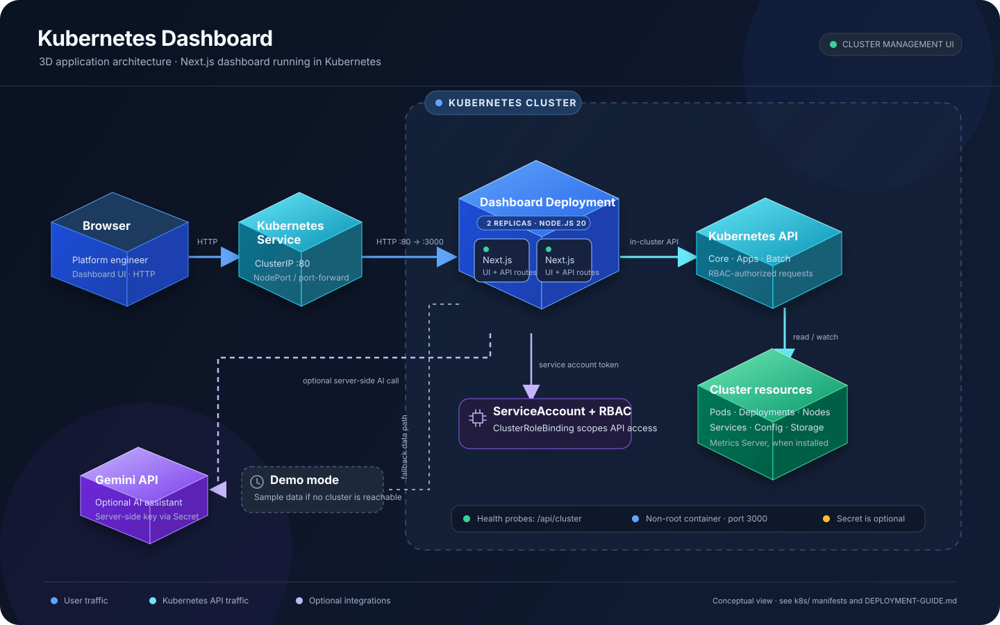

# Kubernetes Dashboard


For a first-person, plain-English project walkthrough for interviews, see [PROJECT-EXPLANATION.md](./PROJECT-EXPLANATION.md). For command-by-command setup and deployment instructions, see [DEPLOYMENT-GUIDE.md](./DEPLOYMENT-GUIDE.md). For future feature ideas, see [future.md](./future.md).

> **An enterprise-ready, developer-first Kubernetes command center engineered for Platform Engineers, SREs, and DevOps teams.**
>
> This dashboard unifies multi-cluster fleet operations, real-time Metrics Server telemetry, AI/GPU accelerator observability, GitOps workflow safeguards (ArgoCD & Flux), next-gen Gateway API routing, and browser-native ANSI container terminal execution. Eliminate tool sprawl, prevent configuration drift, and manage mission-critical cloud-native workloads with velocity and confidence.

---

## 🌟 Key Features

- **Multi-Cluster Context Switcher**: Seamlessly switch between KubeConfig contexts (minikube, EKS, GKE, AKS, Talos, local) from the top navigation bar with dynamic header state.
- **AI Workloads & GPU Observability**: Full GPU accelerator hardware monitoring (`nvidia.com/gpu`, AMD, MIG slices, VRAM footprints) and real-time tracking of AI serving runtimes (**vLLM**, **Ollama**, **KubeRay**, **HuggingFace TGI**).
- **Workload Autoscaling (HPA / VPA)**: Dedicated autoscaling control plane monitoring `HorizontalPodAutoscaler` v2 targets, utilization vs. thresholds, min/max replica ceilings, and conditions.
- **GitOps Awareness & Mutation Guards**: Automated detection of **ArgoCD** and **FluxCD** application tags, sync status badges, and imperative mutation safeguard warnings before scaling or deleting GitOps-tracked workloads.
- **Real Metrics & Resource Monitoring**: Direct integration with Kubernetes Metrics Server (`metrics.k8s.io/v1beta1`) for real CPU/memory allocation, pod density tracking, and trend analysis.
- **Interactive xterm.js Web Terminal**: Full ANSI PTY terminal powered by `@xterm/xterm` with `@kubernetes/client-node` container `Exec` streaming, command history, auto-resizing, and quick diagnostic shortcuts.
- **Dynamic CRD Explorer**: Auto-discover, search, and inspect `apiextensions.k8s.io/v1` Custom Resource Definitions (Cert-Manager, Istio, Prometheus, Karpenter, Kyverno) with live YAML viewing.
- **Gateway API Dashboard**: First-class support for `gateway.networking.k8s.io` (`GatewayClass`, `Gateway`, `HTTPRoute`) including listener protocols, ports, and weighted backend canary routing.
- **Live Pod Log Streaming**: Real-time log inspection with configurable tail lines, container selectors, auto-refresh, and clipboard export.
- **Interactive Topology Map**: End-to-end visual dependency graph tracing traffic from Ingress/Gateway $\to$ Service $\to$ Deployment $\to$ Pod $\to$ Node.
- **Comprehensive Workload Management**: Inspect and manage Pods, Deployments, StatefulSets, DaemonSets, Jobs, and CronJobs with instant scaling, restart, and cordon/drain actions.
- **Security & CIS Audits**: Integrated cluster vulnerability assessments, RBAC visibility, and CIS compliance benchmarks.
- **Helm Hub**: Overview of deployed Helm releases, chart revisions, and quick rollback/uninstall management.
- **Dual-Mode Operation**: Connects directly to real Kubernetes clusters via your local KubeConfig, with a built-in interactive demo engine when no cluster is reachable.
- **Streaming Gemini Assistant**: Ask Kubernetes and troubleshooting questions in an interactive chat panel. Gemini credentials stay on the server, and generated replies stream into the dashboard.

---

## 🐳 Docker Hub Quick Start

[](https://hub.docker.com/r/ayush-singh986/kubernetes-dashboard)

```bash
# Pull and run the dashboard container
docker run -p 3000:3000 -v ~/.kube/config:/root/.kube/config:ro ayush-singh986/kubernetes-dashboard:latest

# Access at http://localhost:3000
```

---

## 🚀 Deployment Options

### Option 1: Docker Compose
```bash
docker-compose up -d
```

### Option 2: Kubernetes Manifests
```bash
# Deploy to your Kubernetes cluster
kubectl apply -f k8s/

# Access via NodePort: http://<node-ip>:30007
```

### Option 3: Local Development
```bash
# Install dependencies
npm install

# Start development server
npm run dev

# Access at http://localhost:3000
```

## 🏗️ Architecture



Browser traffic reaches the dashboard through a Kubernetes Service and is handled by the Next.js application replicas. The server-side API routes use the dashboard ServiceAccount and RBAC binding to access cluster resources. Gemini is an optional server-side integration; demo mode can supply sample data when no cluster is reachable. See the [deployment guide](./DEPLOYMENT-GUIDE.md) and [Kubernetes manifests](./k8s/) for deployment details.

---

## 📄 Dashboard Pages & Routes

| Route | Description |
| :--- | :--- |
| **`/`** | Cluster Overview, health status, node resource gauges, and live event feed |
| **`/workloads`** | Workload control plane (Deployments, StatefulSets, DaemonSets, Jobs, CronJobs) |
| **`/autoscaling`** | HorizontalPodAutoscalers (HPA v2), target utilization metrics, and replica bounds |
| **`/pods`** | Pod management, container status, live logs dialog, and interactive exec |
| **`/deployments`** | Deployment replicas, GitOps tracking badges (ArgoCD/Flux), and rollout controls |
| **`/services`** | Service endpoints, port forwarding mapping, and Ingress routing rules |
| **`/gateways`** | Next-gen Gateway API management (`Gateway`, `HTTPRoute`, `GatewayClass`) |
| **`/crds`** | Dynamic Custom Resource Definitions explorer, API group filtering, and YAML export |
| **`/config`** | ConfigMaps and Secrets inspector with decoded value viewing |
| **`/storage`** | PersistentVolumes (PV), PersistentVolumeClaims (PVC), and StorageClasses |
| **`/helm`** | Helm release management, chart revisions, and application lifecycle |
| **`/nodes`** | Node health, conditions, capacity vs allocatable, cordon and drain controls |
| **`/namespaces`** | Namespace listing, resource quotas, and multi-tenant isolation |
| **`/topology`** | Interactive visual map of cluster traffic flow and resource relationships |
| **`/terminal`** | Standalone xterm.js container shell with ANSI terminal diagnostics |
| **`/ai-workloads`** | GPU hardware monitoring (NVIDIA H100/A100) and live LLM runtime metrics (vLLM, Ollama) |
| **`/security`** | Cluster security audit, CIS benchmark findings, and vulnerability scores |
| **`/monitoring`** | High-resolution CPU, memory, and network utilization charts |
| **`/settings`** | Cluster connection settings, appearance, and dashboard preferences |
| **Dashboard chat panel** | Streaming Gemini assistant for Kubernetes and dashboard questions |

---

## 📸 Gallery

Check out our [**Dashboard Gallery**](./GALLERY.md) to preview screenshots of the dashboard interface, topology map, and terminal!

---

## 📚 Modern Tech Stack

- **Framework**: [Next.js 16](https://nextjs.org/) (App Router, Server Components & Route Handlers)
- **UI Library**: [React 19](https://react.dev/)
- **Styling**: [Tailwind CSS v4](https://tailwindcss.com/) & [shadcn/ui](https://ui.shadcn.com/)
- **Terminal**: [@xterm/xterm](https://xtermjs.org/) & [@xterm/addon-fit](https://www.npmjs.com/package/@xterm/addon-fit)
- **Charts & Graphs**: [Recharts](https://recharts.org/)
- **Icons**: [Lucide React](https://lucide.dev/)
- **Animations**: [Framer Motion](https://www.framer.com/motion/)
- **Kubernetes Client**: [@kubernetes/client-node](https://github.com/kubernetes-client/javascript) (v1.4.0)
- **AI Assistant**: Google Gemini API, called by a server-side Next.js route so its API key is not sent to the browser

### Gemini Assistant Configuration

Set `GEMINI_API_KEY` in the server environment to enable chat. The default model is `gemini-2.5-flash`; set `GEMINI_MODEL` to override it. For Docker Compose, place these values in a local `.env` file or the process environment. For Kubernetes, create a Secret named `kubernetes-dashboard-secrets` with a `GEMINI_API_KEY` key; the deployment reads it optionally, so the dashboard can still start when chat is not configured. Never commit the key or expose it through a `NEXT_PUBLIC_` variable.

The assistant only receives the conversation text submitted in chat; it does not read cluster state or execute commands. The current sign-in flow is a client-side demo and is not server-side authentication. Before exposing the dashboard publicly, protect it with real server-side authentication and apply rate limits at an authenticated gateway to prevent unauthorized use of the paid AI endpoint.

---

## 🔒 Security & RBAC

- The dashboard authenticates using your active `~/.kube/config` context or in-cluster ServiceAccount token.
- Role-Based Access Control (RBAC) manifests are provided in [k8s/rbac.yaml](k8s/rbac.yaml).
- For production multi-tenant environments, mount a restricted ServiceAccount token to enforce cluster policies.

---

## 🤝 Contributing

1. Fork the repository
2. Create a feature branch (`git checkout -b feature/amazing-feature`)
3. Commit your changes (`git commit -m 'Add amazing feature'`)
4. Verify code correctness:
   ```bash
   npm run type-check
   npm run lint
   ```
5. Push to the branch and open a Pull Request

---

## 📄 License

This project is licensed under the MIT License - see the [LICENSE](LICENSE) file for details.
